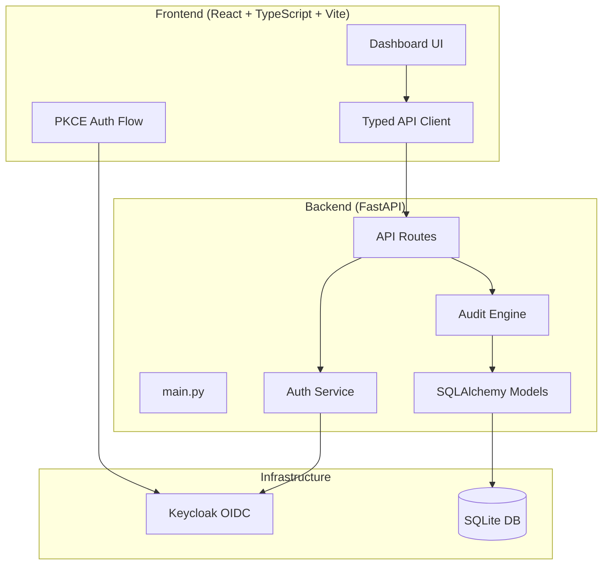

# sentinel-lens-144-alan-vo | Alan Vo | AI & Machine Learning

> Work in progress. This checkpoint may be incomplete or fail tests. See PLAN.md and STATUS.md before use.


A coding-agent skill for multi-phase security audits with independently verified, machine-readable findings.

## Problem & Approach

Security audits of AI/ML codebases require systematic, reproducible analysis that goes beyond simple pattern matching. This tool implements a multi-phase audit pipeline inspired by the Cloudflare security-audit-skill, with a focus on:

- **Deterministic offline core**: Coverage mapping, hunting, and validation run without any LLM
- **Opt-in LLM advisory**: Explanations are labeled advisory, grounded in actual records, with clear provider errors
- **Independent verification**: Every finding passes through a separate verification phase before confirmation
- **Machine-readable output**: Structured JSON findings and coverage ledgers for downstream automation

**Intended users**: Security engineers, AI/ML researchers, and platform teams auditing agentic systems and model-serving infrastructure.

## Architecture



## Features

- **Multi-phase audit pipeline**: Reconnaissance → Hunting → Validation → Reporting
- **Coverage ledger**: Track every code unit's audit status (planned, hunting, covered, deferred, rejected)
- **Findings with verification**: Each finding independently verified before confirmation
- **Prior-run import**: Reuse findings from previous audits of the same target
- **Role-based access**: Viewer, Operator, Admin roles via Keycloak
- **Export workflows**: JSON/CSV export of findings and coverage data

## Quick Start

### Prerequisites
- Docker and Docker Compose
- Python 3.12+ (for local development)
- Node 24+ (for local frontend development)

### Docker Compose (Recommended)

```bash
cp .env.example .env
# Edit .env with your configuration
docker compose up -d
```

Services:
- Frontend: http://localhost:3000
- Backend API: http://localhost:8000
- Keycloak: http://localhost:8080

### Local Development

**Backend:**
```bash
cd backend
python3 -m venv .venv
.venv/bin/pip install -r requirements.txt
PYTHONPATH=. .venv/bin/python -m uvicorn app.main:app --reload --host 127.0.0.1 --port 8000
```

**Frontend:**
```bash
cd frontend
npm install
npm run dev
```

## Testing

```bash
# Backend tests
cd backend
PYTHONPATH=. .venv/bin/python -m pytest tests/ -v

# Frontend tests
cd frontend
npm test
```

## Configuration

See `.env.example` for all configuration options. Key variables:

| Variable | Description | Required |
|----------|-------------|----------|
| `LLM_API_KEY` | LLM provider API key (opt-in) | No |
| `LLM_PROVIDER` | Provider: openai, anthropic, gemini, ollama | No |
| `LLM_MODEL` | Model name | No |
| `LLM_BASE_URL` | Custom base URL | No |
| `KEYCLOAK_URL` | Keycloak base URL | Yes (prod) |
| `KEYCLOAK_REALM` | Realm name | Yes (prod) |
| `KEYCLOAK_CLIENT_ID` | Client ID | Yes (prod) |
| `DATABASE_URL` | SQLite database path | No (default: ./data/app.db) |

## API Reference

### Authentication
- `GET /auth/login` - Initiate OIDC login
- `GET /auth/callback` - OIDC callback
- `POST /auth/logout` - Logout
- `GET /auth/me` - Current user info

### Audits
- `POST /api/audits` - Create new audit run
- `GET /api/audits` - List audit runs (paginated, filterable)
- `GET /api/audits/{id}` - Get audit details
- `GET /api/audits/{id}/findings` - List findings (paginated, filterable)
- `GET /api/audits/{id}/coverage` - Get coverage ledger
- `POST /api/audits/{id}/import` - Import prior run findings
- `GET /api/audits/{id}/export` - Export findings/coverage

## AI/ML Evaluation

This tool's audit engine includes a deterministic offline core for code analysis. LLM-powered explanations are strictly opt-in and advisory.

### Reproducible Baseline
```bash
# Run audit on a test target without LLM
cd backend
PYTHONPATH=. .venv/bin/python -m pytest tests/test_audit_engine.py -v
```

### Metrics Tracked
- **Coverage**: Percentage of code units mapped to audit classes
- **Precision**: Verified findings / total proposed findings
- **Recall**: Verified findings / ground truth (on seeded targets)
- **Cost**: LLM API spend per audit run (when enabled)

### Limitations
- No CVE/advisory database integration (external dependency grounding out of scope)
- Domain-correctness defects outside attack taxonomy may not be mapped
- Quick profile fragile to single malformed hunter return
- Exploitability gating may downgrade deployment-dependent findings
- Weak model tier reduces coverage significantly

## Security Limitations

- Demo mode binds to localhost only; refuses startup in production without valid OIDC config
- All LLM keys server-side only; never exposed to frontend
- Tokens validated for signature, issuer, audience
- No tokens persisted in localStorage; PKCE verifier in sessionStorage only
- SQLite for development; production should use PostgreSQL

## License

MIT License - Copyright (c) 2026 Alan Vo <alanvo@gmail.com>
